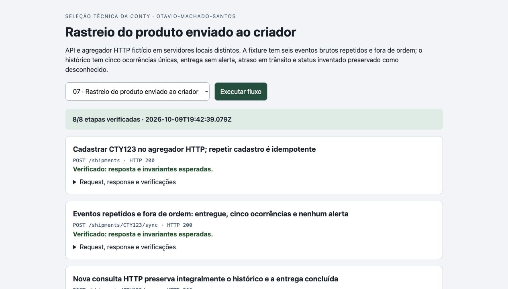
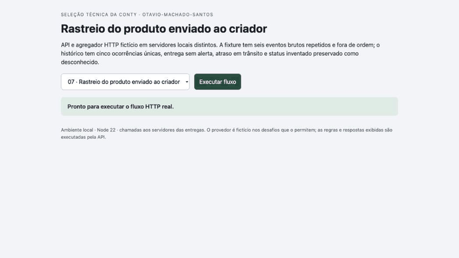

# Verificação final da entrega 7

Código revisado: `b95a0badf514f927d3d349892f7d85c923cda8c9`. Runtime: Node.js 22.23.3 em macOS.

Implementação e documentação: Codex. Revisão: dois agentes Codex independentes do implementador. Não houve revisão humana do código.

- 28 testes passaram no código final; [checkout isolado](evidence/coordenador-clone-limpo.txt).
- [Parecer A](reviews/07-a.json) e [parecer B](reviews/07-b.json), com sondagens independentes, limites e sugestões.
- [Transcrição HTTP real](evidence/coordenador-http.json): 8 etapas verificadas, com requests, respostas e invariantes.
- [Screenshot](evidence/screen.jpg), [resposta expandida](evidence/response.jpg) e [GIF da execução real](evidence/flow.gif).

O GIF foi codificado dos frames de screencast do navegador durante a execução das chamadas locais; não é uma montagem ou simulação. Os dados são fictícios. O portal apenas apresenta respostas da API e compara invariantes. As integrações externas são mockadas quando previsto no enunciado. Os limites de persistência, autenticação e operação estão no README. Os testes e capturas não representam deploy ou funcionamento em produção.

## Registro na Conty

Status observado: **Entrega registrada**, em 2026-10-09T19:46:38.003Z.

- [Link enviado](https://github.com/Otavio-Machado-Santos/conty-rastreio-produto).
- [Página do desafio](https://challenge.appconty.com/desafios/integracao-rastreio).
- [Recibo e texto persistidos](evidence/conty-recibo.json).
- [Screenshot real do registro](evidence/conty-recibo.jpg).

O registro confirma o envio do link; a avaliação da Conty e o ranking dependem da auditoria da organização. Não é uma aprovação técnica pelo avaliador.

## Revisão adicional por Claude Opus 5.5

Após as nove entregas terem sido publicadas e registradas, Claude Code executou a validação solicitada com um subagente independente por desafio, usando `claude-opus-5-5`. Esta entrega recebeu **approved** sobre o código `b95a0badf514f927d3d349892f7d85c923cda8c9`.

- [Parecer, comandos, resultados, sugestões e limites](reviews/claude-opus55.json).
- [Prova do modelo e dos subagentes](reviews/claude-modelo.json).

O modelo foi conferido nos eventos reais da CLI. O coordenador conferiu os hashes e consolidou o parecer final efetivamente emitido para cada commit; os arquivos de prova distinguem a rodada dos nove e as reavaliações. A revisão é assistida por IA, sem revisão humana; a avaliação oficial da Conty continua pendente.
